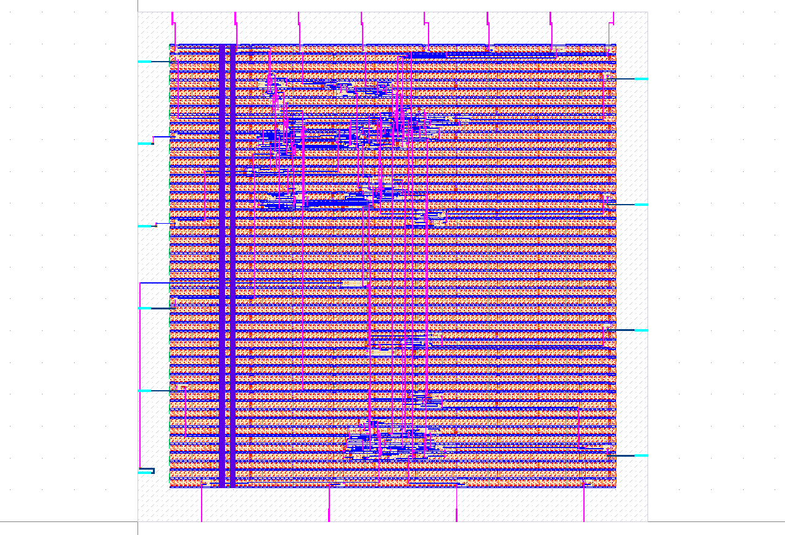
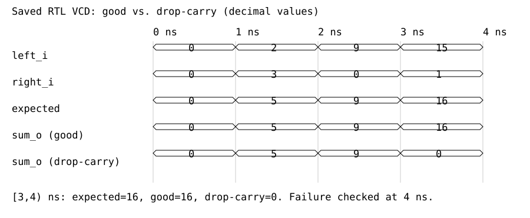

# I see IC vol.3 読者向けファイル

『I see IC vol.3』で調べる，TD4 と論理動作を合わせた小さな CPU と教材です．vol.2 の WSL2＋Docker＋IIC-OSIC-TOOLS 環境を使い，Verilog の計算をシミュレーションで確かめ，CPU コアの GDS を観察します．ROM はコアの外に置きます．

書籍は最終調整中です．タグ `book-vol3-preprint-2026-11-16` で，掲載コードと保存済み結果を参照できます．

EDA 環境がない場合は，まず [章と資料の対応](docs/book_map.md)，[保存した結果の一覧](eda/archive/README.md)，[観察ガイド](docs/observation.md) を読めます．Verilog・ログ・CSV・DEF・ネットリストはテキストです．次の画像もブラウザから参照できます．



TD4-GDS-002 の既存 GDS を筆者が表示した画像です．外形160×160 µmの CPU コアで，ROM，I/O パッド，パッケージは含みません．表示色は層表示設定によります．画像内の灰色の軸線・グリッドと外形を区別してください．



正常版と桁上がり欠落版の比較です．数値は10進数です．テストが入力を切り替える時刻を示し，セル・配線の伝搬遅延は含みません．4 nsで欠落版の不一致を検出して停止します．入力と数値は [CSV](docs/adder-wave-compare.csv) にもあります．

## 最初に試す

WSL2 の Linux 上で，Docker Desktop の WSL Integration，Git，GNU Make，Bash，grep，sed，sha256sum が使えることを前提とします．EDA コンテナは linux/amd64 です．Python 3 は保存資料の確認と波形再描画に使い，GUI 閲覧には GTKWave／KLayout を別途使います．

以下は WSL 上で実行します．取得したリポジトリのルートで各コマンドを使ってください．

```bash
git clone https://github.com/KasHir/iseeic-vol3.git
cd iseeic-vol3
git switch --detach book-vol3-preprint-2026-11-16

make docker-check
make setup
make env-check
make sim DESIGN=adder_lab ADDER_TEST=publication
```

`setup` は次の固定イメージが未取得の場合だけ pull します．環境の導入方法とイメージの直接取得は [環境の説明](docs/portable_setup.md) にあります．

```text
hpretl/iic-osic-tools@sha256:92961478ad3c4f508efb42d9ccdba12ab262eb42a14926d2bd49862230ba8521
```

最初のテストでは `2 + 3: expected=5 actual=5` と `PASS: adder4 one check` が表示され，終了コード0になります．`Outputs:` が今回の run です．入力コピー，環境情報，ハッシュ，`console.log`，`exit_code.txt`，`adder4.vcd` を保存します．

```bash
make sim DESIGN=my_cpu4
make sim DESIGN=adder_lab
make sim DESIGN=adder_lab ADDER_VARIANT=drop-carry
make sim DESIGN=adder_lab
make sim DESIGN=selector_lab
make sim DESIGN=cpu_program_lab
make sim DESIGN=cpu_program_lab PROGRAM_ADD=4
```

CPU はブロック262,176件，状態131,149件の PASS，通常の加算器は五組の PASS を表示します．`drop-carry` は15＋1で期待16／実際0になり，意図した異常終了です（シミュレーションは1，make は2）．その次の通常版では同じ五組が通ります．選択器は `PASS: selector4`，三命令は `PASS: three instructions` を表示します．

## 合成と GDS

```bash
make synth-adder
make synth-adder-sky130
make compare-adder SYNTH_RUN=eda/archive/adder_lab/experiment-synth-sky130-ZckC6fBU
make gds DESIGN=my_cpu4 JOBS=2
```

合成の掲載結果は汎用ゲート20個，SKY130 HD 13個，セル回路との機能比較は256組 PASS です．新しく合成した結果と比較するときは，その `Outputs:` を `SYNTH_RUN` に指定します．単体加算器は合成までで，DEF/GDS は作っていません．GDS 生成の対象は CPU コアです．

保存済み CPU GDS は [my_cpu4.gds](eda/archive/my_cpu4/experiment-gds-BTk6iY3e/runs/implementation/final/gds/my_cpu4.gds) です．EDA 実装環境を導入しなくても，KLayout でトップセル `my_cpu4` を開けます．層名・座標・波形の追加信号は [観察ガイド](docs/observation.md) を参照してください．

実行結果は `eda/designs/<教材名>/runs/` に毎回新規作成します．本の保存資料は `eda/archive/` に分けてあり，再実行しても上書きしません．保存 run にはその時の入力コピーがあり，現在の教材ファイルと同じとは限りません．保存結果と run の対応は [結果の一覧](eda/archive/README.md) で確認できます．

```bash
make verify-saved          # Python 3 だけで保存結果のハッシュと波形を確認
make prepare-adder-wave    # 同梱 VCD から SVG / CSV を再生成
```

`verify-saved` は保存結果を検査します．教材を編集しても，保存結果を変えなければ同じ検査を実行できます．

## 結果の範囲とライセンス

シミュレーション，合成，セル回路との比較，CPU の GDS 生成を固定イメージで確認しています．160 µm角は指定した領域で，最小面積ではありません．100 ns周期は評価条件で，最高動作周波数の測定ではありません．DRC／LVS／Antenna の通過は保存した run の結果で，製造用サインオフの完了を示しません．テスト件数と実装条件は [結果の一覧](eda/archive/README.md) にあります．

自作コード・設定・スクリプト・説明文・自作画像には [MIT License](LICENSE) を適用します．GDS とレイアウト画像には第三者の標準セル形状を含むため，その部分の Apache-2.0 と帰属表示を維持します．詳細は [THIRD_PARTY_NOTICES.md](THIRD_PARTY_NOTICES.md) にあります．
